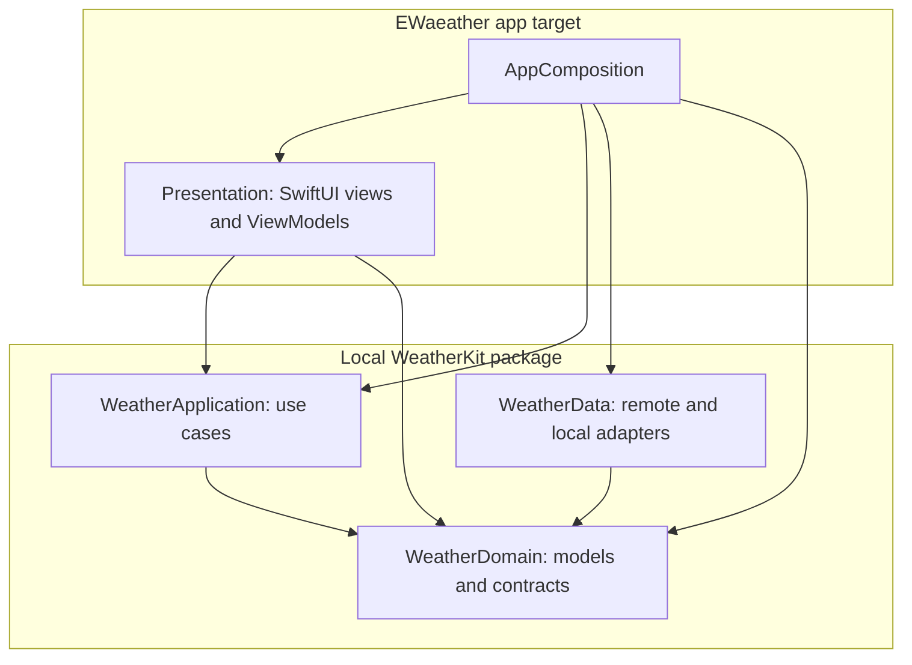

# EWaeather

EWaeather is a native iOS weather app for the Empik iOS recruitment task. Its purpose is to help users find a city and check its weather forecast using Open-Meteo.

The app uses SwiftUI, native navigation, system icons and system colors. The interface is in Polish and follows the device appearance, including Dark Mode.

## Features

City search and weather details use Open-Meteo. Selected cities are saved in UserDefaults. The running app does not use sample city lists or weather values; samples are kept in tests.

- Search city names, including Bielsko-Biała and Nowy Sącz, with input validation and automatic search after a short pause.
- Open a city from search results or saved history and return with the system back button.
- Keep selected cities in history across app launches. Selecting a saved city moves it to the top.
- View current temperature, cloud cover, rain probability with its time range, and up to 24 hourly temperatures.
- Read a forecast for up to three local calendar days from today, with minimum and maximum temperatures, weather descriptions, system icons and maximum daily rain probability.

## Run the app

Clone the repository, then open the Xcode project:

```sh
git clone https://github.com/lukasz654/EWaeather.git
cd EWaeather
open EWaeather.xcodeproj
```

1. Open `EWaeather.xcodeproj` in Xcode 26 or 27.
2. Select the `EWaeather` scheme and an iPhone simulator with iOS 17 or later.
3. Run the app. Xcode resolves the included local WeatherKit package. No API key or third-party dependency is required.

For a physical device, select your signing team in the app target settings. Search and weather loading need an internet connection. Saved city history remains available offline; weather is not cached.

## Architecture

The app follows Clean Architecture with MVVM in the presentation layer. One local Swift package, `Packages/WeatherKit`, contains three library modules. The Xcode app target keeps the interface and dependency composition.

| Module or app area | Responsibility | Project dependencies |
| --- | --- | --- |
| `WeatherDomain` | City and weather models, local calendar days, conditions, city name validation, errors, and small repository contracts | None |
| `WeatherApplication` | Search, hourly and three-day forecast use cases, plus history order and duplicate rules | `WeatherDomain` |
| `WeatherData` | URLSession transport, HTTP errors, Open-Meteo requests, response mapping and UserDefaults history storage | `WeatherDomain` |
| `EWaeather/Presentation` | SwiftUI views, observable screen models, navigation and display formatting | `WeatherApplication`, `WeatherDomain` |
| `EWaeather/App` | Entry point and dependency composition | All three modules |



An arrow means a source code dependency, not the order of runtime calls. SwiftPM declares the dependencies between the three library modules. Domain and Application do not depend on SwiftUI, URLSession, UserDefaults or provider response types. Application and Data do not depend on each other.

Presentation and composition share one app target. Their boundary is checked in code review: presentation files do not import WeatherData. `AppComposition` creates the live adapters and injects them through domain contracts into use cases, then into screen models. A runtime call can reach a Data adapter through a domain protocol without Application importing Data.

WeatherData exposes the live repository and history storage implementations, plus a transport contract for injection. HTTP handling, request construction, response types, mapping and the stored JSON format stay internal or private. Sample repositories and in-memory history used by tests stay in the test target; they do not become part of the package API.

This split supports SOLID through concrete responsibilities:

- **Single responsibility:** screen models manage presentation state, use cases manage app rules, and adapters handle external data formats and storage.
- **Open/closed:** a different provider can implement the existing contracts and be selected in composition without changing the use cases or screen models.
- **Liskov substitution:** tests check missing results, errors and cancellation, including providers that ignore cancellation. Matching protocol signatures alone is not enough.
- **Interface segregation:** city search, weather loading, history reading and history writing have separate contracts.
- **Dependency inversion:** Application and Data depend on contracts owned by Domain. Concrete adapters are selected in composition.

One local package keeps setup simple while making the core dependencies explicit. Search and forecast remain separate feature folders in the app. There are no additional UI or feature modules for these two screens.

## Search and history behavior

- City names accept Unicode letters, including Polish letters, ordinary spaces and the standard hyphen. Unicode text is normalized. Digits, other punctuation, emoji, tabs and line breaks are rejected. An invalid edit keeps the last valid text and shows a message.
- Search starts from two letters after trimming outer spaces. Shorter input keeps the initial state and history visible. Input is checked again in the use case before a request can be sent.
- A 300 ms pause reduces requests while typing. SwiftUI cancels the previous search task when the query changes. A request identifier also prevents older results from changing the current screen, even if a provider ignores cancellation.
- History contains selected cities, not typed query fragments. It is ordered by the latest selection, with one record per location identifier and no fixed limit. Cities with the same name and different identifiers remain separate.
- History stores the city identity, coordinates and available location details. Read and write contracts are separate. Synchronous history operations share the main actor so read-modify-write steps cannot interleave.
- A history read or write failure shows a separate message and a retry button. It does not block navigation. A failed save keeps the city visible for the current session. Corrupted stored data is reported and is not silently replaced.

## Weather details behavior

- Opening details loads weather using the selected city's coordinates. A different city gets its own screen model and request. Returning to search and opening details again creates a new request; an already loaded model keeps its values when it reappears.
- The screen shows loading, weather values, an empty result, offline or a service/data error. Empty and failed states have a retry button. Retries run in the SwiftUI view task, which is cancelled when the screen closes.
- Closing the screen also invalidates its request identifier. A late response cannot change a newer load, even if the provider ignores cancellation. Concurrent duplicate loads are ignored.
- Missing values show `Brak danych`; missing hourly values keep their timestamp. Current conditions can still be shown when hourly data is unavailable. If current values and the selected future hours contain no weather values, the screen shows an empty result.
- Dates and time ranges use the forecast city's time zone. Repeated local clock hours show UTC offsets so they can be told apart. Rain time ranges also show offsets if a clock change occurs inside the interval.
- The live screen credits Open-Meteo, CC BY 4.0 and GeoNames.

## Forecast for three days

- A separate section appears between current conditions and the hourly list. It requests three days beginning with the city's current day. If the provider has fewer days, the app shows the available data.
- Each row shows the local date and weekday, a Polish weather description with an SF Symbol, minimum and maximum temperatures, and the maximum precipitation probability for that day. The daily condition describes the most severe weather expected that day.
- Daily weather has its own repository, use case, screen model, request, loading state and retry action. A daily error keeps current and hourly weather available. Daily weather can also load when the current forecast fails.
- Both requests belong to separate SwiftUI view tasks. Leaving details cancels them and invalidates unfinished loads. Loaded models keep their values when they reappear; reopening details creates new models and requests.
- Missing values show `Brak danych`. Missing or unknown weather codes show `Brak opisu pogody` and a question mark symbol. A known condition can be shown without temperatures. A selected window with no weather values or known conditions produces the empty state.
- Daily dates are calendar dates, not timestamps. The mapper reads the API's date-only ISO strings without shifting them into the device's time zone. Gregorian date validation, clock changes, month and year boundaries are covered by tests.

## API decisions

- City search uses HTTPS, `URLComponents`, Polish result names and up to 10 matches. It is not limited to Poland.
- Weather requests ask for current temperature and cloud cover, plus 25 hourly temperature and rain probability steps. Only fields used by the app are requested.
- Temperatures use Celsius. Unix timestamps stay absolute; display formatting uses the forecast's time zone. Unknown forecast zones and unexpected units are data errors.
- The use case selects up to 24 steps strictly after the current weather timestamp. Rain probability comes from the first selected step and refers to the hour ending at that timestamp.
- Daily requests use `forecast_days=3`, `timezone=auto`, `timeformat=iso8601` and only `weather_code`, `temperature_2m_min`, `temperature_2m_max` and `precipitation_probability_max`. The current and hourly request still uses Unix timestamps.
- Daily units, array lengths, date order, duplicate dates, finite temperatures, minimum/maximum order and percentages are validated. Unknown weather codes have a neutral fallback.
- Missing values stay missing. They are never changed to zero or replaced with a later hour. Mismatched hourly arrays, duplicate times and percentages outside 0–100 are rejected.
- Missing search region or country is allowed. If a search result has no time zone, its model uses GMT as a fallback. Weather details use the time zone returned by the forecast request.
- HTTP errors are separate from data errors and offline failures. Timeouts and other connection failures are service errors. Cancellation is passed back without a user error. Server messages stay in the data layer.

The request contract follows the [Geocoding API documentation](https://open-meteo.com/en/docs/geocoding-api) and [Forecast API documentation](https://open-meteo.com/en/docs). Test responses are written from that contract; they are not recordings from the live service.

## Tests

Select the `EWaeather` scheme and use Product > Test or Command-U for the app tests. Run all package tests from the repository root with:

```sh
swift test --package-path Packages/WeatherKit
```

| Test target | Scope | Tests |
| --- | --- | ---: |
| `WeatherDomainTests` | City names, local calendar dates, identity and missing daily values | 8 |
| `WeatherApplicationTests` | Search, hourly and daily selection, time boundaries, cancellation and history rules | 23 |
| `WeatherDataTests` | HTTP, hourly and daily requests, mapping, weather codes, dates and isolated history storage | 34 |
| `EWaeatherTests` | Screen states, debounce, retry, cancellation, dates, and independent forecast integration through composition | 54 |

Package tests do not import the app. Domain and Application tests do not import WeatherData or use real network or storage implementations. App integration tests use the public data API with controlled HTTP responses. The app and data test targets each keep their own small transport stub so test helpers are not exposed as a library product.

## Validation and limits

- **Automated checks:** 65 package tests and 54 non-UI app tests passed on macOS: 119 tests in total. The temporary app check uses copies of the app and test files linked to the actual local package products. It does not copy core module source. These are logic and integration tests, not iOS UI tests.
- **Builds:** Debug build-for-testing and the Release app build passed for the iOS Simulator with Xcode 27.1 after adding the three-day forecast. The author previously confirmed that selected city history stays after restarting the app.
- **Compatibility:** the project targets iOS 17 or later on iPhone. Source compilation passed for the app, all three modules and all four test targets with the iOS 17 simulator target on arm64 and x86_64. This does not launch the app. An actual run on an iOS 17 device or runtime remains unverified.
- **Remaining device checks:** typing and pasted validation in the real keyboard, offline recovery and retry, leaving a request in progress, and all screen states on smaller phones and larger text.

The app does not cache weather. Internet access is required to load new search results and forecasts. History stores selected cities, rather than every typed query. History deletion is outside this version's scope. The optional multi-day forecast is implemented for three days.

## Data source

City search and weather use [Open-Meteo](https://open-meteo.com/), with weather attribution under [CC BY 4.0](https://creativecommons.org/licenses/by/4.0/). Location data comes from [GeoNames](https://www.geonames.org/). Test weather values are created locally.
