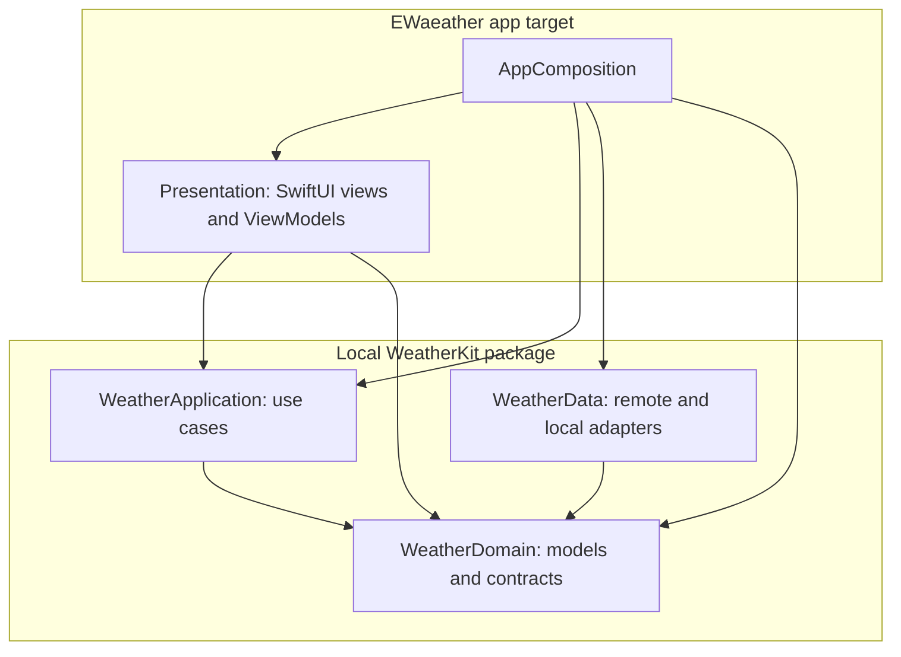

# EWaeather

EWaeather is a native iOS weather app for the Empik iOS recruitment task. It helps users find a city and check its weather forecast using Open-Meteo.

The app uses SwiftUI, native navigation, system icons and system colors. The interface is in Polish and supports Dark Mode.

## Features

City search and weather details use Open-Meteo. Selected cities are saved in UserDefaults. The running app does not use sample city lists or weather values; samples are kept in tests.

- Search city names, including Bielsko-Biała and Nowy Sącz, with input validation and automatic search after a short pause.
- Open a city from search results or saved history and return with the system back button.
- Keep selected cities in history across app launches. Selecting a saved city moves it to the top.
- View current temperature, cloud cover, rain probability with its time range, and hourly temperatures for the next 3, 5, 8 or 12 hours.
- Read a forecast for up to three local calendar days from today, with minimum and maximum temperatures, weather descriptions, system icons and maximum daily rain probability.

## Run the app

Clone the repository, then open the Xcode project:

```sh
git clone https://github.com/lukasz654/EWeather.git
cd EWeather
open EWaeather.xcodeproj
```

1. Open `EWaeather.xcodeproj` in Xcode 26 or 27.
2. Select the `EWaeather` scheme and an iPhone simulator with iOS 17 or later.
3. Run the app. Xcode resolves the included local WeatherKit package. No API key or third-party dependency is required.

For a physical device, select your signing team in the app target settings. Search and weather loading need an internet connection. Saved city history remains available offline; weather is not cached.

## Architecture

The app follows Clean Architecture with MVVM in the presentation layer. One local Swift package, `Packages/WeatherKit`, contains three library modules. The Xcode app target keeps the interface and dependency composition.



Arrows show source code dependencies. Detailed module boundaries and design decisions are described in [Architecture](docs/architecture.md).

## Tests

Select the `EWaeather` scheme and use Product > Test or Command-U for the app tests. Run all package tests from the repository root with:

```sh
swift test --package-path Packages/WeatherKit
```

Package tests cover domain rules, use cases and data adapters. The Xcode app tests cover screen models, request cancellation, retry, formatting and integration with controlled API responses. Tests use local fixtures and isolated storage.

## Limitations

Internet access is required for new search results and forecasts. Weather is not cached. History stores selected cities and remains available between app launches. History deletion is outside this version's scope.

## Documentation

- [Architecture and design decisions](docs/architecture.md)
- [Application behavior and API decisions](docs/behavior.md)
- [AI contribution guide](AGENTS.md)

## Data source

City search and weather use [Open-Meteo](https://open-meteo.com/), with weather attribution under [CC BY 4.0](https://creativecommons.org/licenses/by/4.0/). Location data comes from [GeoNames](https://www.geonames.org/).
